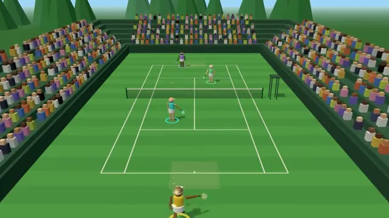

# Rally Court

Arcade tennis where your timing aims every shot. A multiplayer starter game from [Multiplayer Agent](https://multiplayeragent.com): 3D, versus, 2–4 players, with bots that fill the empty spots.

## How it plays

Your player runs to the ball by itself; swing as it reaches you. Early goes cross-court, late goes down the line, right on time is a power shot. First to 4 games wins, with a tiebreak at 3–3; doubles once 3 people are here.

**Controls:** Space to swing, K to lob, arrows or WASD to steer (← → aim the serve) · touch: stick, SWING, LOB.

## Make it yours in the Game Builder

Open the [Game Builder](https://multiplayeragent.com), choose **Start from a starter game** and pick Rally Court. It opens as version 1 in your studio, ready to play and publish. Then ask for changes, for example:

- Make it a clay court at sunset with orange dust puffs
- Add a super shot meter that fills up during long rallies
- Make the ball speed up a little with every shot in a rally

## Run it yourself

1. Get a free publishable key (`pk_…`) at [multiplayeragent.com](https://multiplayeragent.com).
2. In `index.html`, put it in place of `pk_REPLACE_ME` in the `MP_CONNECT` block.
3. Serve the folder with any static web server (3D games load `libs/three.module.min.js` as a module, which browsers block from `file://`). No build step needed.

Without a key it still runs, offline against a bot.

## How it is built

- One `index.html`, plus three.js in `libs/`. The comment at the top of the script maps the code and explains the multiplayer.
- **Host-run rules:** The host's browser calls every bounce in or out, keeps the score and plays the bots; if it leaves, the next player takes over. Your own swing is judged on your screen, from the moment you pressed, so a shot you see is the shot you get.
- **Bots:** Bots fill every empty spot, so alone you play a full match against one.
- **Leaderboard:** Each player's longest rally, in shots.
- **Live sync:** Every player, swing and shot moves for everyone at once. A shot is sent once and every screen works out its arc and bounces itself.
- `?attract` runs it offline, bots only, in doubles. The preview video is recorded from it.

## License

MIT.
